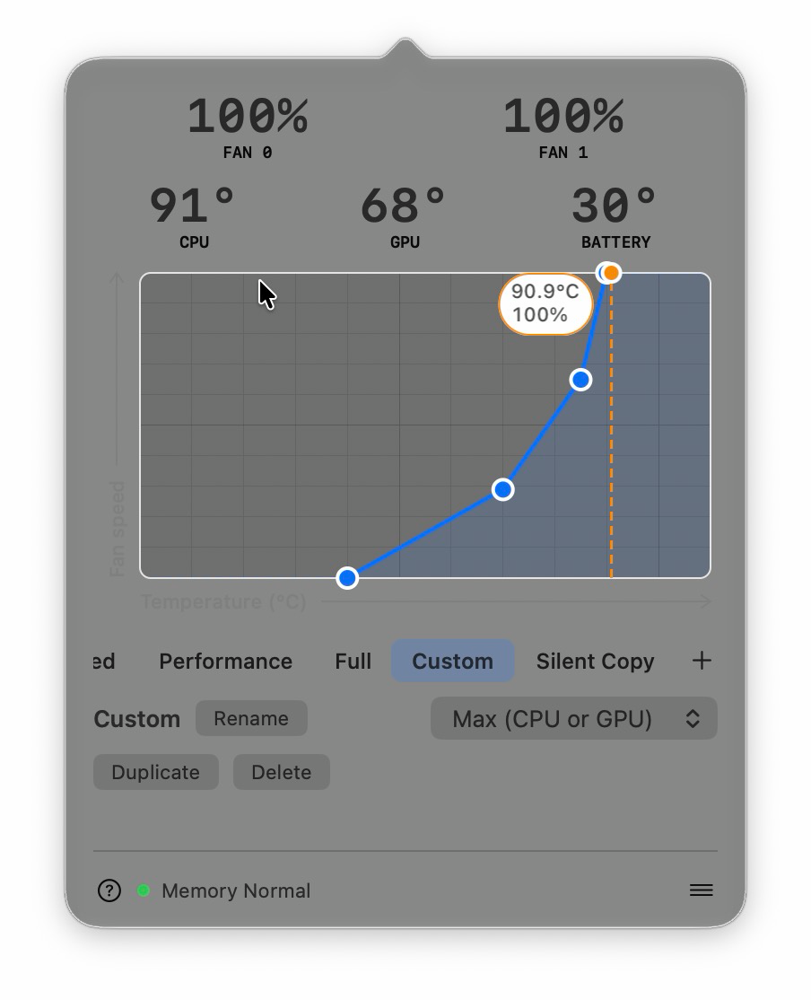
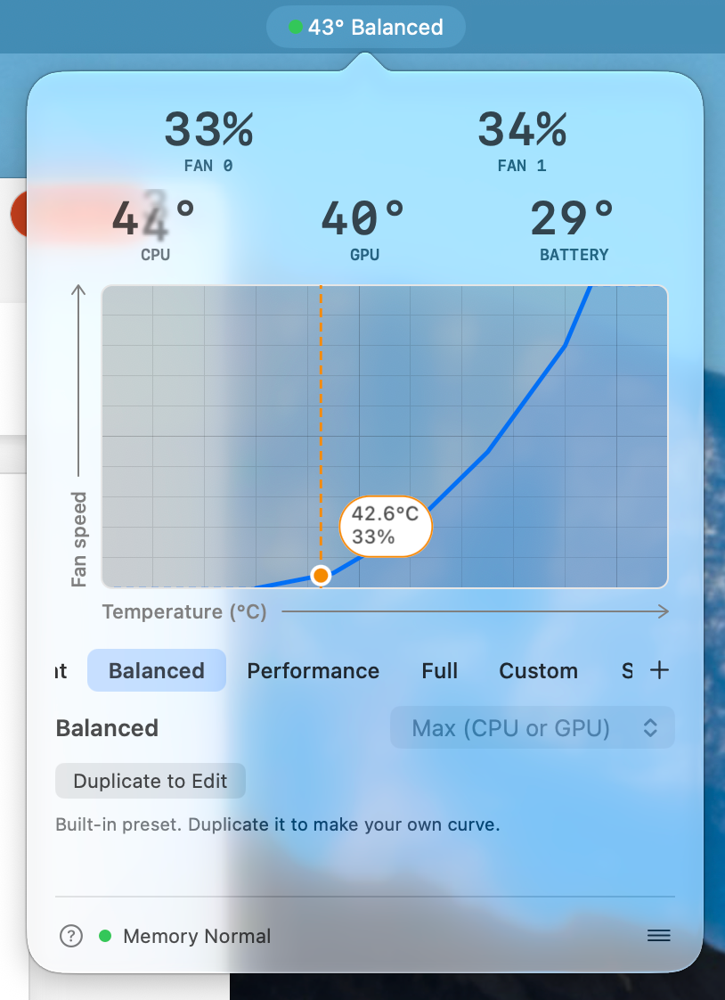

<div align="center">


# OpenFan

**Your Mac's fans, on your terms: a tiny menu-bar app that shows every temperature and lets you draw the curve.**

[](https://github.com/stevenahhh/openfan/releases/latest)
[](https://github.com/stevenahhh/openfan/actions/workflows/ci.yml)


[](LICENSE)


&nbsp;&nbsp;


<sub>Left: the built-in Balanced preset at idle. Right: your own curve under load, both fans at full speed.</sub>

</div>

## Why OpenFan

- **Laptops and desktops.** MacBook Pro, Mac mini, Mac Studio and iMac: OpenFan finds however many fans your Mac has
  and controls each one. Desktops simply drop the battery column; fanless MacBook Airs still get every temperature.
- **Every Apple silicon generation.** M1 to M5, with each chip's own temperature sensors and fan keys, including the
  extra unlock M3 and M4 need.
- **Curves you draw.** Drag points on a graph, follow the CPU, the GPU, the hotter of the two or the battery, and save
  it as a preset that is one click away. Silent, Balanced, Performance and Full are built in.
- **Quiet when it can be.** Below a curve's bottom edge the fans go back to macOS, so a cool Mac stays silent.
- **Safe by design.** A small root helper is the only thing that touches the SMC. It writes the target speed before
  taking manual control, keeps every value inside the fan's limits, and gives the fans back to macOS if the app quits,
  crashes, goes quiet for 12 seconds or the Mac goes to sleep. At 95 °C the fans go to full speed, whatever the curve
  says.
- **Your menu bar, your way.** Write the menu-bar text yourself from `{cpu}`, `{gpu}`, `{rpm}`, `{preset}` and friends,
  with an Activity-Monitor-style memory pressure dot.
- **Nearly free to run.** 0.0 to 0.1 % CPU and under 30 MB with the popover closed, and the helper takes about 2.5 MB;
  it reads the sensors only as often as what is on screen needs.
- **Updates in one click.** A signed, verified update when there is one, and nothing at all when there is not: no
  notifications, no background timer.
- **Native and open.** Swift and AppKit, Liquid Glass on macOS 26, no dependencies, MIT licensed.

> Verified on the MacBook Pro Mac17,9 (M5 Pro). The other Macs above are supported by the code but not yet measured on
> real hardware; see [Supported Macs](#supported-macs) and help by sending your Mac's evidence.

## Install

1. Download `OpenFan.zip` from the [latest release](https://github.com/stevenahhh/openfan/releases/latest), unzip it
   and move `OpenFan.app` to `/Applications`.
2. Open it. The app is ad-hoc signed and not notarized, so the first launch needs a right-click on the app and
   **Open** (or `xattr -dr com.apple.quarantine /Applications/OpenFan.app`).
3. Click the menu-bar item, open the **☰** menu in the popover footer and choose **Install Helper…**. That asks for
   an administrator password once and installs a small root daemon
   (`/Library/LaunchDaemons/com.stevenahhh.openfan.helper.plist`), the only process that writes to the SMC. Until it
   is installed OpenFan only shows temperatures and the fans stay with macOS. **Uninstall Helper…** in the same menu
   removes it.

## Using it

The menu bar shows `52° 2.3k` by default. Clicking it opens the popover:

- **Header**: CPU, GPU and battery temperatures and one column per fan. Click the fan row to switch between percent
  of full speed and rpm; the choice is remembered.
- **Presets**: **Auto** hands the fans back to macOS (a mode, not a preset). **Silent**, **Balanced**,
  **Performance** and **Full** are built in and read-only; duplicate one to make it yours. Full holds every fan at
  maximum speed. Clicking a preset activates it and shows its curve.
- **Curve editor**: drag a point to move it, double-click empty space to add one, right-click a point to remove it.
  Every edit is saved when you let go of the mouse and applied right away. The pop-up menu next to the name picks
  what the curve follows: the hottest of CPU and GPU, the CPU, the GPU or the battery average. A curve that reaches
  its bottom edge hands the fans back to macOS (the graph says Auto there), which lets them stop while the Mac is
  cool. Whatever a curve follows, the fans go to full speed when the CPU or GPU reaches 95 °C.
- **Footer**: hovering **?** explains the editor, a dot shows memory pressure the way Activity Monitor colours it,
  and the **☰** menu holds Menu Bar Text…, the helper and Quit.

**Menu Bar Text…** opens the settings page. The text is a template; click a name to insert it, and the preview shows
what the menu bar will say:

| name | value |
|---|---|
| `{max}` | hottest of CPU and GPU |
| `{cpu}`, `{gpu}` | CPU, GPU |
| `{bat}` | battery average |
| `{rpm}` | fastest fan |
| `{rpm0}`, `{rpm1}` | first, second fan |
| `{preset}` | active preset |

Anything else is shown as typed, up to 40 characters. An empty field shows only the memory pressure dot, which can be
turned off on the same page; **Default** restores `{max}° {rpm}`.

Your presets live in `~/Library/Application Support/OpenFan/presets.json` and the settings in `settings.json` next to
it. An unreadable settings file is kept as `settings.json.bak` and the defaults are used.

## Updates

OpenFan looks for a newer release every time it starts, and when the popover opens at most once a day. Nothing appears
unless there is one: then the footer shows **Update available!**. Clicking it downloads the release, checks its
Ed25519 signature against the key built into the app, the bundle and the code signature, swaps the app and relaunches.
If anything fails, the installed app stays as it was and the label offers a retry. There are no notifications and no
background timer.

When a release changes the helper, the popover says so and the **☰** menu gets **Update Helper…** (one administrator
password). The fans keep working with the old helper until then.

## Supported Macs

Verified on one model so far: the MacBook Pro Mac17,9 (Apple M5 Pro, two fans).

OpenFan is written to also handle, untested:

- M1 to M4 chips, with their own temperature keys and fan mode key; M3 and M4 need the `Ftst` unlock
- One-fan MacBook Pros
- Mac mini, Mac Studio and iMac, without the battery column and the battery curve input
- Fanless MacBook Airs, with temperatures only

Intel Macs are not supported. The helper writes to the SMC on your behalf, so on any other Mac start with the read-only
probe, which prints your model, fans and sensors:

```sh
swift run --scratch-path build/scratch OpenFanProbe
```

[docs/hardware](docs/hardware/README.md) lists the verified models and explains how to add yours.

## Safety model

- Writes go to `F{n}Tg` (target RPM, clamped to `[Mn, Mx]`) **before** the fan's mode key is set to manual. Engaging
  manual mode without a target stops a fan.
- A curve at 0 % releases the fan instead of asking for the lowest speed, so no target below `Mn` is ever written;
  leaving that zone re-engages target-first.
- The daemon holds a 1 s control timer only while controlling, and releases the fans when its client stops talking
  for 12 s, when the client's socket closes, on SIGTERM/SIGINT/SIGHUP, and before sleep. It also resets a stale
  manual mode (and a stale `Ftst`) at startup.
- A failed SMC write degrades to monitor-only mode and refuses further control commands.
- Only root and the installing user may talk to the daemon (`getpeereid`), and every value it accepts is range-checked.

## Build from source

Requires Xcode (for the `#Preview` macros and `actool`).

```sh
bash scripts/build-app.sh          # builds, compiles the icon and ad-hoc signs build/OpenFan.app
open build/OpenFan.app
```

With only the Command Line Tools, remove `Sources/OpenFanUI/Previews.swift` before building. The app icon is the
Icon Composer document `Resources/OpenFan.icon`; open it in Icon Composer to edit it.

Checks (XCTest is unavailable with the Command Line Tools, so they are executables):

```sh
swift run --scratch-path build/scratch CoreCheck      # presets, curves, protocol, updates
swift run --scratch-path build/scratch ControlCheck   # the control engine
swift run --scratch-path build/scratch SMCCheck       # reads this Mac's SMC; never writes
```

### Xcode canvas

Open `Package.swift` in Xcode, then `Sources/OpenFanUI/Previews.swift`, and turn the canvas on with
**Editor ▸ Canvas**. It declares the popover, plus light and dark variants. For a plain window, run the **OpenFanPreview** scheme:
it hosts the same controller with sample data. Both use a throwaway store in the temporary directory and never touch
the real settings, presets or helper. The UI lives in the `OpenFanUI` library because Xcode does not preview an
executable target from a Swift package.

### Layout

| path | what |
|---|---|
| `Sources/OpenFanSMC` | AppleSMC access and sensor discovery |
| `Sources/OpenFanCore` | fan curve, presets, settings, socket protocol, update checks |
| `Sources/OpenFanControl` | the decision engine (hysteresis, dead band, panic) |
| `Sources/OpenFanHelper` | the root daemon: socket, lease watchdog, control tick, sleep handling |
| `Sources/OpenFanUI` | the popover and its views, plus the preview harness |
| `Sources/OpenFan` | the menu bar app: status item, telemetry, helper client, updater |
| `Sources/OpenFanPreview` | a window that hosts the popover with sample data |
| `Sources/OpenFanProbe` | a read-only report of a Mac's SMC |
| `Sources/*Check` | the executable checks |
| `Resources` | `Info.plist` and the Icon Composer icon |
| `scripts` | app build, helper install and uninstall, update signing |
| `docs/SPEC.md` | the researched implementation spec |
| `docs/hardware` | measured evidence per Mac model, and the template for adding yours |

## Contributing

Pull requests are welcome, above all for support of other Macs. See [CONTRIBUTING.md](CONTRIBUTING.md) and
[docs/hardware](docs/hardware/README.md); report security problems as described in [SECURITY.md](SECURITY.md).

## License

[MIT](LICENSE): free to use, modify, distribute and sell, commercially too.

There is no warranty, and this software writes to your Mac's SMC through a root helper. Read the safety model above,
check [docs/hardware](docs/hardware/README.md) to see whether your model has been verified, and use it at your own risk.

OpenFan was written from scratch. The AppleSMC protocol and the key names were learned from open-source projects such
as [Stats](https://github.com/exelban/stats), [SMCKit](https://github.com/beltex/SMCKit),
[fand](https://github.com/yolo-labz/fand) and [fanctl](https://github.com/erogol/fanctl) (all MIT). No code was copied
from them or from any other project that was read; that was checked line by line.
